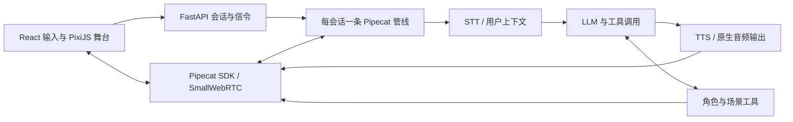

# 雨夜咖啡馆

一个可本地运行的实时角色互动场景。用户与 26 岁旅行摄影师米拉通过文字或按住说话交流，驱动角色表情、动作、照片展示和剧情选择。前端使用 React / TypeScript / PixiJS，后端使用 Python / FastAPI / Pipecat。

本交付提供源码和本地启动说明；无需部署演示站点。默认 Mock 模式无需 API Key，真实语音与模型使用 Live 模式。

## 1. 一条命令启动

前置环境：**Node.js 22.12+、uv、Python 3.12**，以及可访问项目依赖镜像的网络。如果未安装 Python 3.12，uv 可按 `.python-version` 下载解释器；下载受网络条件影响。安装工具本身属于前置环境准备。

在仓库根目录打开终端，执行：

```bash
npm start
```

脚本检查环境和端口，分四阶段输出进度：按锁文件安装前端和 Python 依赖，创建根目录 `.venv`，执行类型检查与前端生产构建，然后启动一个 Python 服务。健康检查通过后显示访问地址；前端缺包或锁文件不一致时自动重新安装。依赖、下载缓存和构建产物保存在项目内，不修改全局镜像设置。

浏览器打开 **[http://127.0.0.1:7860](http://127.0.0.1:7860)**，保留默认的 **Mock** 模式，点击“坐下来聊聊”。Mock 无需麦克风权限，可以操作“按住说话”模拟输入，或直接发送文字；Live 首次使用需允许麦克风权限。结束时在启动终端按 `Ctrl+C`。

无需先执行 `npm install`、复制 `.env`、安装 Docker、下载浏览器或重新生成素材。中文 WAV 和精灵图集已随源码提供。本轮已验证源码包解压后，在没有 `.env`、`node_modules` 和 `.venv` 的目录中执行同一命令，自动安装依赖、构建并启动 Mock 成功。前置工具已安装，首次下载耗时仍取决于网络，不把本机结果当作其他环境的安装保证。

### 模式与验收范围

| 模式         | 输入与回复                                                       | 验证范围                                                                    |
| ------------ | ---------------------------------------------------------------- | --------------------------------------------------------------------------- |
| Mock（默认） | 文字或页面选择的**模拟转写文本**；规则回复和预生成中文 WAV | 实际 WebRTC、舞台、剧情、打断、故障恢复；不验证真实语音识别或开放式模型理解 |
| Live         | 真实麦克风流式识别或文字；流式 LLM、工具调用与 TTS               | 需配置第三方密钥与资源权限；当前未完成真实 ASR / TTS 联调                   |

Mock 的按住说话只演示输入与中断链路，不识别麦克风中的词句。健康接口为 `GET /api/health`；其中 `live_available` 仅检查两个密钥是否非空，不代表第三方账号可用。

### 五分钟体验路线

1. 发送“你在等谁？”：观察回避表情和看窗动作。
2. 发送“可以看看那张照片吗？”：展示海边旧照，灯光变暖。
3. 发送“我陪你再等一会儿。”或“你可以给朋友发条消息。”：进入不同剧情收束。
4. 米拉说话时再次发送文字，或按下“按住说话”：旧声音、临时字幕和动作立即停止，新一轮继续。
5. 打开“调试”，分别尝试模型超时、TTS 失败、照片失败和旧结果迟到；再次输入验证恢复。

### 启动排查与分步执行

- 找不到 `uv` / Node：安装前置工具，重新打开终端；Python 版本由根目录 `.python-version` 指定为 3.12。
- 7860 端口占用：关闭已运行的本项目实例或占用该端口的程序后重试。
- 依赖下载失败：检查网络与项目镜像配置。Python 使用根目录 `pyproject.toml` 中的华为镜像，npm 使用 `.npmrc` 中的 npmmirror；锁文件固定具体版本与来源。
- 页面连不上或没有声音：先检查 `/api/health`，再检查浏览器权限和 Console、后端同会话同轮次日志；本机防火墙也可能影响 WebRTC UDP。

需要逐步定位时，在根目录依次执行以下命令；正常体验只需 `npm start`：

```bash
npm ci
uv sync --all-packages --locked
npm run build
uv run --all-packages python -m uvicorn app.main:app --app-dir apps/server --host 127.0.0.1 --port 7860 --no-access-log
```

前端热更新：保持后端运行，另开终端执行 `npm run dev`。Vite 的 `/api` 代理默认指向 7860。

## 2. 系统结构与主要模块



媒体和交互事件通过 WebRTC 音轨与 RTVI 数据传输。生产模式由同一个 FastAPI 进程提供页面、会话 API 和信令，无需另起前端服务器、数据库或媒体服务器。每个会话拥有独立上下文和场景状态，数据保存在进程内存中。

| 位置                                               | 职责                                                        |
| -------------------------------------------------- | ----------------------------------------------------------- |
| `apps/server/app/main.py`                        | 健康检查、会话凭据、SmallWebRTC 信令、静态页面              |
| `bot.py`                                         | 原生管线、PTT 策略、音频写出、字幕与中断确认                |
| `interaction.py`                                 | 会话状态、generation 代次隔离、照片确认                     |
| `services.py` / `volcengine.py`                | Mock 服务、LLM 包装、豆包 WebSocket ASR 与 HTTP Chunked TTS |
| `story.py` / `tools.py`                        | 角色提示词、示例对白、三个白名单工具                        |
| `apps/web/src/App.tsx` / `Stage.tsx`           | 连接和输入、状态更新、动画和场景呈现                        |
| `apps/web/public/assets/`                        | 原创 SVG、66 帧精灵图集、28 段 Mock 中文 WAV                |
| `scripts/` / `apps/server/tests/` / `tests/` | 启动、素材重建、打包；Python 回归与浏览器端到端测试         |

管线顺序为：输入 → RTVI / 控制消息 → STT → 用户聚合 → LLM → TTS → 音频输出 → 助手聚合。Mock 与 Live 共用传输、中断和场景实现，仅替换模型服务。

## 3. 语音交互与打断流程

采用**按住说话（PTT）**，没有自动监听自然开口。PTT 使录音边界明确，减少环境噪声误触发和演示中的连接复杂度。

1. **按下**：前端立即静音、清除临时字幕和动作、切换 listening，并递增 generation；后端中断旧 LLM / TTS 与输出队列。中断不等待 ASR 完成。
2. **按住**：Live 为本轮建立独立 WebSocket，发送 16kHz / 单声道 / PCM16，约每 200ms 一包；临时转写只更新“听到的内容”。Mock 使用页面选定的模拟文本。
3. **松开**：关闭麦克风，发送末包，等待最终识别结果；只有最终文本进入模型。客户端最多按住 15 秒，异常或空结果提示重试。
4. **回答**：流式 LLM 生成短对白并调用工具，按句流式合成 24kHz PCM；首段音频实际写出 WebRTC 后更新句子字幕和 speaking，播放完成回到 idle。
5. **下一次输入**：再次按下 PTT 或发送文字都会打断当前回答。异步结果在请求发起时绑定 generation，服务端和前端共同丢弃旧轮次的识别、模型、工具与字幕结果。

前端静音时继续消费 RTP，不暂停音频元素。松开按钮不会恢复旧声音；等待原生中断清理确认，且新一轮确有音频写出后才解除静音。中断确认超时会断开并提示重连。文字输入也先完成代次握手，再使用 SDK 原生 `sendText`。

照片采用 `scene.applied` 确认：浏览器加载并呈现成功后，后端才记录照片与暖光事实。打断回退未确认的预览，保留已确认的照片，避免模型将失败动作视为已完成。

## 4. 角色和场景指令设计

`story.py` 的 `persona(scene)` 将指令分为对白规则、角色背景、工具约束、已确认场景事实和短对白示例：米拉是暴雨后在咖啡馆等待老朋友的旅行摄影师，通常用一两句第一、第二人称口语回应。要求模型只输出可直接朗读的对白，避免旁白、括号动作、Markdown 和工具参数；背景用于理解，舞台表现交给工具。此约束依赖模型遵循提示词，没有运行时旁白清洗器。

| 工具                  | 参数与约束                                                | 效果                                           |
| --------------------- | --------------------------------------------------------- | ---------------------------------------------- |
| `perform_character` | guarded / curious / warm；none / look_window / hold_photo | 三种表情及看窗、举照片动作                     |
| `share_photo`       | 无参数，固定素材 ID                                       | 展示旧照片，成功确认后转暖光                   |
| `close_scene`       | stay / message；必须已展示照片                            | 记录陪伴或主动联系的剧情选择；不会实际发送消息 |

Pydantic 限制参数，工具不能指定任意资源 URL 或执行代码。场景只保留照片、灯光、结局与 revision，模型依据已确认快照判断；普通闲聊不要求每轮调用表情工具。

## 5. 模型、媒体方案与第三方服务

| 能力        | 当前实现                                                                                                                                            |
| ----------- | --------------------------------------------------------------------------------------------------------------------------------------------------- |
| LLM（Live） | Pipecat 原生 OpenAI 兼容适配，接入豆包方舟；模板模型`doubao-seed-2-1-pro-260628`，可改账号可用模型或接入点；代码未配置模型时回退 `gpt-4.1-mini` |
| ASR（Live） | 豆包流式语音识别 2.0，WSS`/api/v3/sauc/bigmodel_async`；默认资源 `volc.seedasr.sauc.duration`                                                   |
| TTS（Live） | 火山 V3 HTTP Chunked，HTTPS`/api/v3/tts/unidirectional`；资源 `seed-tts-2.0`，固定可配置音色                                                    |
| Mock        | 规则对白与 Microsoft Huihui 系统语音预生成 WAV；运行时不调用云模型                                                                                  |
| 浏览器媒体  | Pipecat 官方客户端 + SmallWebRTC；Python 端使用 aiortc；单音频元素播放                                                                              |
| 角色呈现    | PixiJS AnimatedSprite + 脚本生成原创 SVG；speaking 循环动画，句子级字幕，不是字级口型同步                                                           |

Pipecat 固定为 1.12.0，客户端固定 client-js 1.13.1、client-react 1.8.2、small-webrtc-transport 1.10.8；其他实际依赖版本见两个锁文件。FastAPI、React、Vite、httpx、websockets 支持 API、构建和薄协议适配，没有修改框架源码。素材来源及许可范围见 [ASSETS](docs/ASSETS.md) 和 [THIRD_PARTY_NOTICES](THIRD_PARTY_NOTICES.md)。

### 配置 Live

将 `.env.example` 复制为根目录 `.env`，填写下列项并重启 `npm start`，在页面切换 Live：

```dotenv
VOLCENGINE_API_KEY=你的豆包语音APIKey
VOLCENGINE_STT_RESOURCE_ID=volc.seedasr.sauc.duration
VOLCENGINE_TTS_RESOURCE_ID=seed-tts-2.0
VOLCENGINE_TTS_SPEAKER=zh_female_vv_uranus_bigtts
LLM_BASE_URL=https://ark.cn-beijing.volces.com/api/v3
OPENAI_API_KEY=你的方舟APIKey
LLM_MODEL=账号可用的模型ID或ep-接入点ID
LLM_THINKING=disabled
LLM_TIMEOUT_SECONDS=20
```

语音 Key 与方舟 Key 属于不同服务。`OPENAI_API_KEY` 是沿用的变量名，接入方舟时填方舟 Key；`LLM_BASE_URL` 不追加 `/chat/completions`。ASR / TTS 资源和音色必须与账号权限匹配，旧的 `volc.bigasr.auc_turbo` 不适用于当前 WebSocket 接口。完整说明见 [.env.example](.env.example)。系统环境变量优先于 `.env`；密钥只在后端使用，不提交进源码。

`LLM_THINKING` 通过 `thinking.type` 透传给兼容接口；留空则不发送该参数。模型单次网络等待限制为 10 秒，关闭 SDK 自动重试，每次请求总时限默认 20 秒。已有对白且仅调用表情工具时跳过重复推理；照片和剧情工具保留必要续答。页面 thinking 仅表示应用正在等待，不表示模型深度思考开关。

## 6. 关键技术选择与取舍

- **Pipecat 原生管线与中断**：复用传输、上下文、工具与任务清理，避免自建 Agent 编排或音频队列；代价是需要按固定框架版本处理帧和事件。
- **SmallWebRTC 本机直连**：浏览器与一个 Python 服务即可演示；当前没有 TURN，公网和复杂 NAT 网络需要额外部署。
- **PTT 优先**：录音与中断行为易理解、易复现；牺牲免按键自然对话。
- **Mock / Live 共用流程**：没有密钥也能检查完整媒体与交互链路；Mock 结果不能证明真实模型或语音质量。
- **精灵动画与有限场景工具**：素材小、确定性强、易展示场景变化；没有 3D、视频角色或音素级口型。
- **generation 与前端确认**：防止取消后迟到结果污染新轮次，防止未加载照片污染剧情；增加少量状态与握手逻辑。
- **内存状态与单场景**：保持实现简洁；重连、服务重启会丢失剧情，没有账号、持久化或多实例共享状态；长期对话暂未做上下文截断或摘要。

## 7. 验证方式与已知问题

本轮交付的执行结果、环境和源码包说明见 [交付检查](docs/DELIVERY.md)。以下命令不会主动调用真实付费服务：

```bash
npm test              # Python 协议、取消隔离、工具确认、API 和日志回归
npm run build         # TypeScript 检查与生产构建
npm run test:e2e      # 先启动 npm start；Chrome / WebRTC Mock 端到端测试
```

浏览器测试在 Windows 优先复用已安装 Chrome，可用 `CHROME_PATH` 指定路径；没有可用浏览器时执行 `npx playwright install chromium`。测试使用虚拟麦克风。`npm run record` 可录制 Mock 演示，录制还需 Playwright ffmpeg，说明见 `scripts/record.mjs`；录屏组件不是本地体验的启动前置条件。

控制台默认 INFO / UTF-8，输出带会话与轮次的最终输入、合并回复、异常及 ASR → LLM → 工具 → TTS → WebRTC 写出耗时。被打断的回复会标记，生成文字不等于用户已听完。密钥遮盖，不记录原始音频、请求头或堆栈局部变量；浏览器错误可在 Console 查看。

当前限制：

- 真实火山 ASR / TTS 尚未完成账号联调；配置检查和本地协议模拟不能证明中文识别、听感、权限与服务时延。
- 历史记录有一次授权的豆包 Turbo 请求测量，首段文字约 2.95 秒、单次请求约 3.72 秒；这不包含 ASR、工具续答、TTS 和浏览器播放，模板 Pro 模型也未由此得到验证。
- 手机尺寸截图属于自动布局检查，iOS / Android 实机权限、扬声器与触摸打断仍待验收。
- 无自然 VAD 打断；PTT 权限失败时保留文字入口。字幕为句子级，角色没有真实口型同步。
- 没有公网 HTTPS / TURN、用户登录、限流与持久化。会话上限为 8，面向本地演示，不能直接当作生产服务。
- 提示词不能完全保证 Live 不生成旁白；Mock 只覆盖有限话题。Microsoft 系统语音资源的其他分发用途需核对许可或替换为授权录音。

Docker 保留为可选 Linux 启动方案：`docker compose up --build`，使用 host 网络连接 aiortc UDP。当前交付推荐上述本机启动；Docker 构建未在本轮验证。

## 8. 投入时间与两周演进

**累计投入约 30 小时**（作者提供的估算，包含设计、实现、调试、测试与交付整理）。
