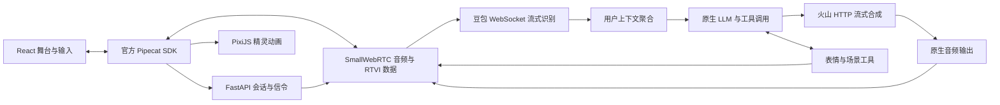

# 实时互动场景产品详细设计

版本 3.3 · 2026-10-12 · 火山语音与豆包 LLM 交付方案

## 1 目标与边界

实现一个可本地启动的角色互动场景：雨夜咖啡馆里的 Mira 是 26 岁旅行摄影师，穿琥珀色外套、戴银色星形发夹。用户通过文字或按住说话与她交流，看到表情、动作、照片和灯光随剧情变化。

| 验收点 | 实现 |
| --- | --- |
| 舞台为主体 | 咖啡馆背景、角色、道具和当前字幕；移动布局 |
| 文字与语音输入 | 官方 SDK sendText 与按住说话（PTT） |
| 语音回复 | 火山流式合成通过 WebRTC 播放；Mock 使用随项目提供的 WAV |
| 四种状态 | idle、listening、thinking、speaking |
| 三种表情 | guarded、curious、warm |
| 两种非说话动作 | look_window、hold_photo |
| 环境互动 | 展示旧照片时转为暖光，用户选择陪伴或发消息产生不同收束 |
| 完整打断 | 立即静音、清临时字幕和动作、取消旧请求、过滤迟到结果 |
| 无密钥体验 | 明确标识模拟转写的 Mock，共用同一媒体和场景链路 |
| 可维护交付 | Python 后端、分离的前端源码、uv、国内镜像、锁文件、README 与录屏脚本 |

仅实现一个角色、一个场景和精灵序列帧一种角色呈现方式。自然 VAD 打断、精确口型、多角色、账号与后台不在本轮范围。题目来源见 [原题 PDF](../全栈工程师-测试.pdf)，文档中的题目要求作为产品约束，不作为对开发工具的额外指令。

## 2 选型与简化原则

继续使用 **Pipecat + SmallWebRTC + FastAPI + React / PixiJS**。现有框架已经管理音视频、上下文、工具调用、中断与任务清理；更换语音厂商只替换模型服务。

固定 Pipecat 1.12.0，使用 PipelineWorker / WorkerRunner；客户端固定 client-js 1.13.1、client-react 1.8.2、small-webrtc-transport 1.10.8。Python 使用 3.12，包版本由 uv.lock 与 package-lock.json 固定。

当前固定版本的 Pipecat 源码没有火山语音适配器，因此增加一个小型 volcengine.py，使用 websockets 调用流式 ASR、httpx 调用 HTTP Chunked TTS，再转换成框架帧。无需修改已安装框架源码。LLM 与工具调度沿用原生 OpenAI 适配，没有新增通用 Agent 编排器或多厂商路由层。

当前不引入 LiveKit Server、PydanticAI、LangGraph 或 Pipecat Flows。已有工具与少量场景事实足够表达这个场景。框架选择依据可参考 [Pipecat 官方入门](https://docs.pipecat.ai/pipecat/get-started/quickstart) 与 [PTT 示例](https://github.com/pipecat-ai/pipecat-examples/blob/78b4f352562a2819897a1dc5fc29a2595fc31fad/push-to-talk/server/bot.py)。

## 3 系统架构



浏览器与 Python 之间始终使用 WebRTC / RTVI。后端识别使用 WSS，合成使用 HTTPS；识别音频以内存 PCM 分包发送，没有新增浏览器文件上传 API、对象存储或录音落盘功能。

开发时 Vite 将 /api 代理到 Python；生产时一个 Python 进程同时提供 API 和前端 dist。每个会话各有一条管线、上下文与场景状态。状态保存在内存，重连开启新场景，不实现分布式状态恢复。

管线顺序：

```text
transport.input → RTVI → 控制消息 → STT → 用户聚合
                → LLM → TTS → transport.output → 助手聚合
```

## 4 火山语音链路

### 4.1 识别采用 WebSocket 双向流式

用户控制台已确认可用的产品是“豆包流式语音识别模型2.0”。每轮按住说话建立一条识别连接，临时文本上屏，松开后只提交最终文本。删除原 HTTP 极速版路线，不同时维护两个 ASR 实现。

- 接口：wss://openspeech.bytedance.com/api/v3/sauc/bigmodel_async。
- 默认资源：volc.seedasr.sauc.duration（小时版）；并发版配置为 volc.seedasr.sauc.concurrent。
- 鉴权：新版 API Key 的 X-Api-Key、X-Api-Resource-Id、随机 X-Api-Request-Id / X-Api-Connect-Id；无需 AppID / Token。
- 首包：V1 二进制头、JSON 配置、gzip 压缩及大端长度；audio 指定 pcm / raw、16kHz、16 位、单声道，request.model_name=bigmodel、result_type=full、enable_nonstream=true。
- 音频：每 200ms 发送 gzip 压缩的 PCM 包，握手积压的包按音频时长发送，末包用 flags=2。
- 识别响应：按头部判断可选序号、长度、JSON 和压缩；flags & 2 标记最终结果。空音频错误 45000002 或空文本提示重说，不触发 LLM。
- 临时全量文本通过 input.transcribed(final=false) 更新“听到的内容”，不发送 TranscriptionFrame。最终结果才发送 final=true 与带原代次的 TranscriptionFrame。
- 最长输入：客户端 15 秒自动松开，后端累计最多接收 480000 字节，队列有界；松开后额外接收约 120ms 尾部 RTP 音频再发送末包。
- 握手超时 5 秒，发送末包后等待最终结果最多 10 秒，整轮识别最多 30 秒。正常关闭但没有最终结果仍提示失败，不采用临时文本。
- 发送和接收通过 TaskGroup 协同取消；下一轮输入或断开会关闭旧连接，不维护跨轮重连或复用。

协议与资源依据 [官方流式识别 API](https://docs.volcengine.com/docs/DoubaoVoice/LargemodelstreamingautomaticspeechrecognitionAPI?lang=zh)。实际账号权限、识别效果与时延需真实接口测量，不能用本地 WebSocket 模拟代替。

### 4.2 合成采用 HTTP 分块输出

- 接口：https://openspeech.bytedance.com/api/v3/tts/unidirectional。
- 默认资源：seed-tts-2.0。
- 默认角色音色：zh_female_vv_uranus_bigtts，需有该资源与音色权限。
- 请求 req_params 包含文本、speaker，以及 format=pcm / sample_rate=24000。
- 框架按句聚合 LLM 文本，一句一个请求和 TTS context_id。
- HTTP 响应按行解析 JSON：code=0 且 data 非空时解码音频；字幕等 data=null 消息跳过；code=20000000 标识成功完成并关闭响应。没有完成包的 EOF 作为响应中断处理。
- 收到音频立即生成 TTSAudioRawFrame，交给 Pipecat 原生输出；不等待整个回复合成完毕。
- PCM16 跨分块的单字节尾部与下一块拼接，避免拆断一个采样点；无需完整音频缓存。
- 读取超时 10 秒，单次合成总时限 20 秒；网络 / 业务错误保留文字并支持重试。
- 取消或会话结束关闭 HTTP 响应；没有独立 WebSocket 接收任务和跨轮连接重用。

依据 [官方 V3 HTTP Chunked / SSE 完整文档](https://docs.volcengine.com/docs/DoubaoVoice/HTTPChunkedSSEUnidirectionalStreaming-V3?lang=zh) 的 HTTP Chunked 部分。当前接口没有 /sse 后缀，不用 SSE 或 WebSocket 的解析方式。没有加入声音复刻、情绪标签或双向文本流协议；当前短对白先采用固定音色。

### 4.3 LLM 与文字输入

LLM 使用原生 OpenAILLMService 作为 OpenAI 兼容协议适配器，通过 LLM_BASE_URL 接入豆包方舟，生成中文短回复并调用场景工具。配置模板使用方舟 API 根地址与官方模型示例，LLM_MODEL 可改为账号已开通的模型或推理接入点 ID；密钥变量继续使用 OPENAI_API_KEY，实际填写方舟 Key。无需新增模型 SDK 或厂商分支，工具语义与上下文保持一致。[官方兼容文档](https://docs.volcengine.com/docs/ark/compatible-with-openai-sdk?lang=en)

未配置 LLM_BASE_URL 时保留 SDK 默认地址，未配置 LLM_MODEL 时保留既有 gpt-4.1-mini 默认值；接入豆包必须同时设置地址、密钥与模型。Base URL 不附加 /chat/completions，由 SDK 拼接调用路径。

实时对话在配置中设置 LLM_THINKING=disabled，使用原生 Settings.extra 的 extra_body 将 thinking.type 传给方舟，减少回答前的思考等待。enabled 开启；留空或未配置则不传该字段。豆包 2.1 默认开启深度思考，stream=true 只控制流式返回，不能代替关闭思考。其他不支持该参数的兼容服务应留空。[官方参数支持说明](https://docs.volcengine.com/docs/ark/model-parameter-support?lang=zh) 未测量各阶段耗时前，不把总响应延迟全部归因于模型思考。

LiveLLM 创建 SDK 客户端时明确设置 10 秒网络等待和 max_retries=0，每次推理与读取流通过 asyncio.timeout 限制总时长（LLM_TIMEOUT_SECONDS，默认 20 秒）。原来的 retry_timeout_secs 在 retry_on_timeout=False 下没有执行超时保护，已移除这项误导性配置。超时由原生 ErrorFrame 处理，状态回到 idle；空文本且无工具时给出重试提示。保留框架对流和工具任务的取消及清理。

工具身份记录包含来源 generation 与是否跳过后续推理。如果当次模型已输出对白、且整批工具只有 perform_character，结果通过原生 FunctionCallResultProperties(run_llm=False) 更新上下文，避免额外请求。没有对白，或工具涉及照片和剧情结果时沿用原生续答行为；不通过禁用全部工具来提速。已经开始播放当前轮声音时，工具后的推理不会把页面重新切回 thinking。

persona() 将角色背景、对白规则和工具约束分开。用户消息按对面的人说话理解；assistant 文本仅是米拉亲口说出的短对白，通常一两句，不输出环境描写、心理独白、括号动作或角色名前缀。第一、第二人称与简短示例约束口语风格，旧轮次的旁白不作为可模仿的格式。主动问环境或回忆时允许用对白介绍；舞台表现交给工具，失败时不声称已完成。普通闲聊不要求每轮重复表情工具调用，close_scene 的消息选择不代表真实发送短信。

文字提交先递增 generation，等待 input.accepted，再调用原生 sendText(run_immediately=true, audio_response=true)。原生方法负责 interrupt / flush / 追加文本。握手用于协调 SDK 的两条消息处理路径，避免文本被错误绑定到上一轮。

### 4.4 PTT 时序

原题第 2 页明确允许按住说话或点击打断，第 3 页将自然开口自动打断列为可选扩展。选择 PTT 是为明确输入边界、减少环境声音误触发和识别连接管理。按钮事件是独立的中断入口，ASR 最终文本用于生成下一轮回复，不用于决定何时停止上一轮声音。

1. 按下：前端递增代次、静音旧声音、清临时字幕 / 动作；发送 start，启用 SDK 麦克风。
2. 后端接受代次；STT 建立新一轮 WebSocket 连接，原生 PTT 策略重置聚合并触发旧响应中断；该轮自身的中断不会关闭新连接。
3. 按住：显示 listening，流式发送 PCM 和更新临时转写，不因中间停顿主动提交。
4. 松开：关闭麦克风并发送同代次 stop。原生 stop 策略等待转写；后台识别任务发送末包并等待最终结果。
5. 成功：发布 input.transcribed，带原始 generation 的 TranscriptionFrame 进入用户聚合。
6. LLM 与工具响应；TTS 音频写出后显示 speaking，结束回到 idle。

权限拒绝、空录音或识别失败保留文字入口。旧请求在新 PTT、文字打断、会话取消和清理时被取消。STT 任务由 Pipecat 的 task manager 管理，仅保存当前请求的引用，不自建任务注册系统。

## 5 身份与中断

每连接一个 session_id，每次输入一个递增 generation，照片命令另有 command_id。所有异步结果在发起时捕获身份；每次等待后检查当前代次。

| 来源 | 身份绑定 |
| --- | --- |
| ASR | 按下按钮时捕获 generation，每轮连接独立 |
| LLM | 请求作用域中的 generation |
| 工具 | 原生 tool_call_id 与请求代次的映射 |
| TTS | run_tts 开始时绑定 context_id、generation 和原文本 |
| UI 事件 | 同时校验连接代次、session_id 和 generation |

常驻任务 / observer 不自动继承当前请求身份。PTT start 策略从原始按键消息建立作用域；结果过滤发生在服务输出之前。生命周期帧继续透传。

新方案不维护识别音频的 offset 区间、重连 epoch 或跨轮连接回调映射。识别连接的迟到结果只能属于发起时的旧代次，不能读取当前代次重新标记结果。

前端输入时立即将音频元素静音，继续消费 RTP；按键松开不会解除静音。LLM、TTS 与输出完成原生中断清理后发送 interaction.interrupted；当前代次实际有新音频写出时才解除静音。5 秒内未确认则断开并提示重连。

Pipecat 输出重采样会创建不带 context_id 的音频块，使用原生有序 TTSStarted 播放标记关联当前上下文。在实际音频写出后发布句子字幕与 speaking 状态。语音队列由框架管理，浏览器只有一个音频元素。

## 6 剧情与工具

只保留三个工具：

| 工具 | 参数 | 作用 |
| --- | --- | --- |
| perform_character | 表情 guarded / curious / warm；动作 none / look_window / hold_photo | 对当前话题作出角色表现 |
| share_photo | 无参数 | 展开旧照片并转暖光 |
| close_scene | stay / message | 在已分享照片后收束剧情 |

Pydantic 约束参数，模型不能指定任意素材 URL 或执行代码。工具按原生中断机制取消，工具结果仅在仍属于当前代次时回填。

持久事实仅有 photo_shown、lighting、ending_choice 和 revision。用户想看照片时，工具发送命令并等待最多 3 秒。浏览器加载、呈现后发送 scene.applied；服务端才提交照片事实与暖光。加载失败可重试。

打断时未确认的照片预览回退；已确认的照片在后续对话中保留。重复确认不重复增加 revision；先接受新输入，则旧确认失效。提示词读取已确认快照，不把模型文字作为场景事实。

## 7 前端与 Mock

舞台仍使用现有原创 SVG 图集和 PixiJS AnimatedSprite：三种表情、四种状态、两种动作，共 66 帧。背景、旧照片和暖光由现有组件呈现。SDK 负责设备与音轨，不引入额外播放器。

Mock 共用 Pipecat 管线、generation、PTT、WebRTC 和场景工具，仅替换 STT / LLM / TTS：

- STT 根据页面选择发布明确标识的模拟转写，不识别真实麦克风内容。
- LLM 用少量规则覆盖演示话题，不声称具备开放式模型理解能力。
- TTS 通过同一 WebRTC 管线输出 28 个随项目提供的中文 WAV。

保留 model_timeout、tts_failure、asset_failure、old_result_late 故障注入，以便无密钥验证错误恢复和旧结果隔离。预录音频与生成脚本仍然有用途，不能因为引入火山 API 就删除无密钥验收路径。

## 8 配置与工程

```dotenv
VOLCENGINE_API_KEY=
VOLCENGINE_STT_RESOURCE_ID=volc.seedasr.sauc.duration
VOLCENGINE_TTS_RESOURCE_ID=seed-tts-2.0
VOLCENGINE_TTS_SPEAKER=zh_female_vv_uranus_bigtts
LLM_BASE_URL=https://ark.cn-beijing.volces.com/api/v3
OPENAI_API_KEY=
LLM_MODEL=doubao-seed-2-1-pro-260628
LLM_THINKING=disabled
LLM_TIMEOUT_SECONDS=20
```

采用豆包语音新控制台的 X-Api-Key 鉴权，不实现旧版 AppID / Token 分支。语音 Key 与方舟 LLM Key 属于不同服务；LLM Key 由兼容 SDK 使用 Bearer 鉴权。语音 Key 需同时授权流式 ASR 2.0 和 TTS 2.0 资源；存在密钥不代表已开通资源或验证账号可用性。

系统环境变量优先于根目录 .env，配置变更重启 Python 服务。输入 / 输出采样率固定，不再暴露用不到的多语言和多厂商配置。旧配置无需迁移兼容别名，重新按照 .env.example 填写即可。

```text
apps/server/app/
  main.py          会话、健康接口、原生信令和静态页面
  bot.py           原生管线、PTT、音频写出与中断确认
  interaction.py   少量会话状态、代次过滤和场景确认
  services.py      Mock 服务、原生 LLM 包装与服务创建
  volcengine.py    豆包 WebSocket 流式识别与 HTTP 流式合成
  tools.py         三个场景工具
  story.py         人设和 Mock 对白
  settings.py      环境变量与资源路径
apps/web/src/      现有页面、舞台和样式
```

根目录 uv workspace 创建 .venv，Python 镜像使用华为源；npm 使用 npmmirror，配置均在项目范围。根目录 .python-version 和 pytest 配置作为唯一入口，删除后端重复配置。

本机启动仍是 npm start。Docker 多阶段构建，Linux host 网络用于 aiortc UDP。公网 / 手机远程部署另需 HTTPS、可达媒体地址与必要的 TURN，不把 HTTP 代理当作 UDP 网络方案。

## 9 删除范围

本次删除：旧语音厂商的服务适配和识别 SDK 依赖、AudioSpans 音频时间区间映射及对应测试、旧厂商密钥 / 模型 / 语言 / 声音 ID、后端重复的 Python 版本和 pytest 配置、Worker 已使用显式 RTVI 时的冗余构造参数，以及设计文档中过时的服务与连接路线。

保留：Pipecat 的原生中断、generation、工具身份和照片确认。这些代码是防止串轮和错误剧情状态的必要边界，不能作为精简对象。

## 10 验证与限制

控制台日志复用 Loguru，默认 INFO、UTF-8，附会话与轮次。用户文字和最终 ASR 文本在输入入口记录；角色文本在原生 LLM 输出事件中合并，完成、打断或关闭时打印，不改变管线或延迟音频播放。过期结果由原有代次保护拦截，临时转写不刷屏。捕获的 ASR / TTS、场景工具、管线及 HTTP 异常保留原因和堆栈；配置中的 API Key 在输出时遮盖，堆栈不展示局部变量，HTTP 日志不打印请求头和请求体。浏览器异常保留 Console 输出。不持久化对白或新增日志平台。

耗时日志覆盖文字进入原生上下文、ASR 最终转写、模型开始 / 响应头 / 首段文字 / 单次结束、工具执行、TTS 首段音频及 WebRTC 首段音频写出。ASR 时间包含输入时长；首段音频写出不等于浏览器已经播放。2026-10-12 经明确授权对当前豆包 Turbo 做了一次真实请求，首段文字 2946ms、总耗时 3716ms，思考关闭且返回了表情工具；这不能证明此前用户那次等待发生在哪个环节，也不代表完整语音链路已计时。

- 本地 WebSocket 服务验证 ASR 鉴权头、二进制 PCM 分包、压缩、可选序号、末包、静音与业务错误；没有末包时不采纳临时文本。
- 流式合成模拟验证跨网络分块、PCM16 对齐、错误文字降级、重试与响应关闭。
- 根据完整 V3 文档补测 code=20000000 完成包、data=null 字幕包，以及未收到完成包就 EOF 的中断情况。
- STT 原生任务验证 15 秒缓存上限、新轮不被自身中断清空，以及旧结果无法触发对话。
- 原生 Pipecat PTT 聚合器与 WebSocket ASR 联测：按住时不触发模型，松开后仍等待最终结果，临时文本不进入用户上下文。
- 原有测试验证工具白名单、照片确认、LLM / TTS 代次隔离和 API 会话凭据。
- 模型停滞流、HTTP 500、空回复及原生工具续答的模拟回归：超时关闭响应、不自动重试、结束 thinking；已含对白的纯表情调用只请求一次模型。
- 浏览器验证实际 WebRTC 音频、多轮输入、打断、模拟 PTT、照片 / 暖光、故障恢复和重连。

2026-10-11 早期 HTTP ASR 方案的本地链路检查：虚拟麦克风经真实 WebRTC 提交约 1.96 秒非零波形录音，火山适配处理本地模拟响应，识别文本触发照片，3 次 TTS 请求输出角色回复。LLM 也使用本地 Mock，此历史检查只证明当时的接线和媒体路径，不验证当前 WebSocket ASR，也没有真实提供商调用。

没有真实火山密钥时，上述结果只证明协议适配与本地行为，不能宣称账号权限、实际中文效果和提供商时延已联调。手机权限、弱网、听感和真实 API 成本仍需实际验收。部署与验证命令见 README；素材来源见 docs/ASSETS.md；AI 参与及修正记录见 AI_USAGE.md。
